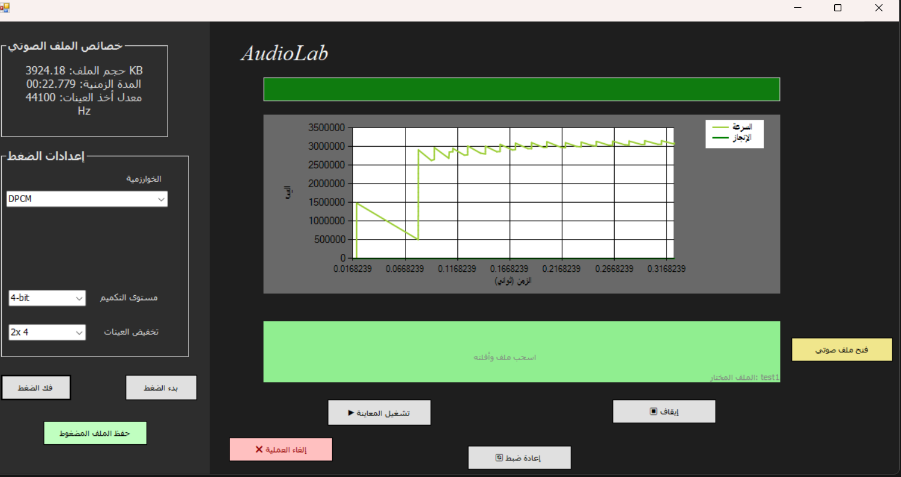

# Audio Compressor

A Windows desktop app (C# / WinForms, .NET Framework 4.8) that compresses and decompresses WAV audio
using classic waveform-coding algorithms. Built as a multimedia course project.

## Features
- Load a WAV file by dialog or drag & drop, with file info (size, duration, sample rate, channels, bit depth)
- Playback of the original and the decompressed result
- Three algorithms:
  - **DM** – Delta Modulation (1 bit per sample, fixed step size)
  - **ADM** – Adaptive Delta Modulation (step size doubles/halves based on the last bit)
  - **DPCM** – Differential PCM with selectable quantization: **8-bit** (1 byte/sample, 2:1 vs 16-bit PCM) or **4-bit** (two samples packed per byte, 4:1)
- Optional downsampling before compression, with upsampling on decompression
- Compression runs on a background task: **progress bar**, **cancel button**, and a live **speed/progress chart**
- Compression report: size before/after, saving %, time, algorithm settings
- Save the compressed data to disk

## Project structure
| File | Purpose |
|------|---------|
| `AudioCompressorCore.cs` | Pure algorithm code (compress/decompress), UI-independent |
| `Form1.cs` / `Form1.Designer.cs` | UI and event handling |
| `Program.cs` | Entry point |

## Build & run
1. Open `AudioCompressor.slnx` (or `AudioCompressor/AudioCompressor.sln`) in Visual Studio 2022 or later.
2. Restore NuGet packages (NAudio 2.3.0) and press **F5**.

Requirements: Windows, .NET Framework 4.8.

## Notes and limitations
- DM/ADM/DPCM are **lossy**; audio quality depends on step size and downsampling factor.
- The saved compressed file uses a custom raw format and cannot be played by regular audio players;
  use the app's *Decompress* button to play it back.
- Input is limited to WAV files.
- DPCM trade-off: 4-bit halves the size again but quantization noise is higher (max step error ~64 vs ~4 for 8-bit); both modes can overload on very steep waveforms.

## Recent fixes and improvements
- DPCM: the 4-bit / 8-bit selector now actually works (nibble packing for 4-bit; the bit depth is passed to the decoder).
- DM/ADM: the last partial byte was not written when the sample count was not a multiple of 8.
- DPCM: quantized difference could overflow a byte on large jumps; it is now clamped to 0–255,
  and the predictor is clamped to the 16-bit range in both encoder and decoder.

## Authors
Rakia Omar Al Labani — Damascus University
